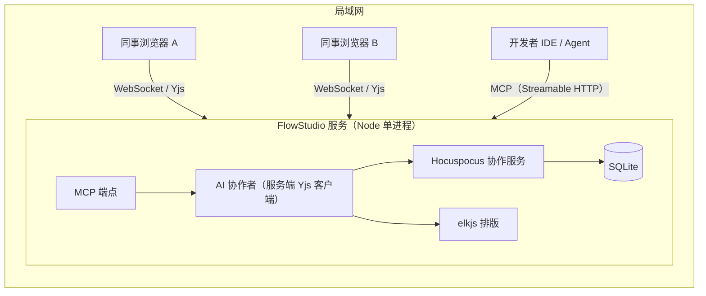

# 在线协作画图平台（暂名 FlowStudio）设计文档

> 日期：2026-11-06 ｜ 状态：草案，待老板审批
> 标注说明：**【老板决定】** = 老板在对话中明确拍板；**【我的决定】** = 设计者给出的默认值，老板可推翻。

---

## 1. 意图与动机

老板从 GitHub 拉取的 Simple Mind Map（Vue 2 + ElementUI）存在三个问题：界面有明显的后台管理风格，不够现代；整体方向和代码老板难以掌控；底层是树状思维导图引擎，不适合画自由结构的图。

老板希望从零搭建一个**局域网内多人实时协作**的画图平台，核心体验是**人机共治**：
- AI（通过 MCP，由开发者在 IDE / Agent 里调用）先快速搭出图的骨架；
- 同事在浏览器里实时看到，并在此基础上手工修改、补充；
- AI 可以再读取当前图，做局部增量修改，**不会冲掉人的改动**。

**成功标准**：局域网内 5~20 名同事同时打开同一张图并流畅协作；开发者一句话让 Agent 生成一张泳道图骨架，同事接手修改；整体视觉达到 Figma / Linear / Excalidraw 这类现代工具的质感。

## 2. 目标 / 非目标 / 反目标

### 目标（第一期）
1. 图类型：**流程图 + 泳道图**【老板决定】。
2. 局域网实时多人协作：实时同步、他人光标、在线头像、选中高亮。
3. AI 入口：**仅 MCP**【老板决定】，AI 作为协作者做增量编辑。
4. 现代美观的界面，支持亮色 / 暗色主题。
5. 一键自动排版（含泳道感知），连线为直角走线。
6. 图文件管理（列表、新建、重命名、删除、复制）+ 版本快照与恢复。
7. 导出 PNG / SVG / JSON。

### 非目标（第一期不做，但底座需预留扩展）
- 架构图、UML、拓扑图（节点类型注册机制需支持后续扩展）【老板决定：后续】。
- 画布内置 AI 对话面板（后续可与 MCP 共用同一套增量操作接口）【老板决定：先走 MCP】。
- 账号体系、权限控制、公网部署。
- 移动端适配。
- 迁移旧 Simple Mind Map 的数据。

### 反目标（技术上能跑但等于失败）
- AI 调用一次就整张覆盖，冲掉同事的修改。
- 界面看起来像后台管理系统（ElementUI 风格）。
- 局域网 10 人协作时操作明显卡顿或出现冲突丢数据。
- 服务重启后数据丢失。

## 3. 约束

- 运行环境：局域网，服务端为 Windows 机器，Node.js 22+，启动方式应像现有 `start.bat` 一样“一键启动”。
- 内网可能无法访问外网：前端依赖必须打包进产物，不使用 CDN；服务端运行时不依赖外网。
- 规模预估：同时在线 ≤ 30 人，单图节点数 ≤ 500。
- 由老板配合 AI Vibe Coding 开发，技术栈要选 AI 生成质量最高的主流组合。

## 4. 方案对比

| 方案 | 优势 | 劣势 | 结论 |
|---|---|---|---|
| **A. React Flow + Yjs** | 节点即 React + Tailwind 组件，视觉上限最高；数据为干净的 nodes / edges，AI 易操作；MIT 协议 | 泳道需自研；内置直角线不避障，需补齐路由 | **【老板决定】采用** |
| B. AntV X6 + Yjs | 内置泳道 / UML 示例、Manhattan 避障路由 | 默认风格偏老，视觉改造成本高；数据结构较啰嗦 | 未选 |
| C. tldraw | 美观、内置多人协作 | 白板语义，不适合结构化图；生产使用需商业授权或带水印 | 排除 |

## 5. 已确定的技术方案

### 5.1 技术栈【我的决定，基于方案 A】
- 前端：Vite + React 19 + TypeScript + Tailwind CSS v4 + shadcn/ui + lucide-react；画布 `@xyflow/react`（React Flow v12）；局部 UI 状态 Zustand。
- 协作：Yjs（CRDT）+ Hocuspocus（Yjs WebSocket 服务端，MIT，自带持久化与鉴权钩子）。
- 排版：elkjs（layered 算法 + ORTHOGONAL 连线路由），前后端都可运行。
- 服务端：Node 22 单进程，同时承载静态资源、Hocuspocus WebSocket、REST API、MCP 端点；存储 SQLite。
- 新建独立仓库，不放在当前 mind-map 仓库内。

### 5.2 整体架构

### 5.3 数据模型【我的决定】
每张图对应一个 Y.Doc：
- `meta`（Y.Map）：标题、图类型、主题、创建时间等。
- `nodes`（Y.Map<id, Y.Map>）：`id / type / position / size / label / style / parentId（所属泳道） / data`。
- `edges`（Y.Map<id, Y.Map>）：`id / source / target / sourceHandle / targetHandle / label / style / waypoints（可选折点）`。
- `lanes`：泳道本身也是节点（`type=pool` / `type=lane`），顺序由 pool 节点的 `laneOrder` 数组维护。

React Flow 只负责渲染与交互，**Yjs 是唯一的事实来源**；本地交互先写 Yjs，再由 Yjs 驱动 React Flow 状态。

### 5.4 第一期节点类型
- 流程图：开始 / 结束、处理、判断、输入输出、文档、子流程、数据库、注释便签、分组框。
- 泳道图：池（pool，支持横向 / 纵向）、泳道（lane）。
- 节点类型通过注册表管理（类型 → React 组件 + 默认尺寸 + 连接点 + MCP 描述），后续扩展 UML、架构图时只新增注册项。

### 5.5 泳道行为
- 泳道可调整宽高、拖拽重排、增删、重命名。
- 节点拖入某条泳道即归属该泳道（更新 `parentId`），拖出则回到画布顶层。
- 泳道随内容自动撑开，不允许节点溢出泳道边界。
- 自动排版时，同一泳道的节点保持在同一条带内（elkjs partitioning）。

### 5.6 连线
- 默认直角走线，带箭头，支持文字标签、实线 / 虚线、颜色。
- 自动排版时使用 elkjs 计算的直角路径（含折点）。
- 手动拖动节点后，相关连线需重新走线并尽量避开节点：先用 React Flow 的 smoothstep 兜底，同时预研避障路由（候选：libavoid-js），**预留约 1 周，是项目主要技术风险**。
- **第一期验收底线**【老板决定】：连线保证直角走线，允许偶尔穿过节点，可以先交付；避障做不成就放到第二期。
- **手动调折点**【我的决定】：用户可以拖动连线的折点（`waypoints`）。手调过的折点在节点移动后保留；执行“自动排版”时清除，改用 elkjs 算出的路径。

### 5.7 实时协作
- 实时同步全部图数据（Yjs）。
- Awareness：他人光标（带名字和颜色）、在线头像列表、他人选中节点的彩色描边。
- 撤销 / 重做：基于 Y.UndoManager，**只撤销自己的操作**，不影响他人。
- 断线自动重连，重连后自动合并。

### 5.8 身份【我的决定】
局域网第一期不做登录：首次打开时填写昵称，系统分配颜色，保存在浏览器 localStorage 中。所有人都可编辑所有图。

### 5.9 AI 人机共治（MCP）
**核心原则**：AI 是一个协作者，不是“整张覆盖”的导入器。

- **接入方式**【我的决定】：服务端提供 MCP Streamable HTTP 端点（如 `http://<内网IP>:<端口>/mcp`），同事的 Agent 只需配置 URL，无需在本机安装；另提供一个轻量 stdio 桥接脚本，兼容只支持 stdio 的客户端。
- **AI 作为 Yjs 客户端**：MCP 调用由服务端内的 AI 协作者连接到对应 Y.Doc 执行；在 Awareness 中显示为“AI · <Agent 名>”，带独立颜色，生成过程中画布上显示“AI 正在编辑…”。
- **AI 不计算坐标**：AI 只描述结构（节点、连线、泳道归属），位置统一由服务端 elkjs 计算。
- **AI 增量修改后的落位：局部重排**【老板决定】：`apply_ops` 新增节点后，只重排受影响的局部，也就是新节点所在泳道；不在泳道里的节点，重排范围是与新节点直接相连的区域。范围外的节点不动。范围内同事手调过的位置可能会变，但这些位置变化属于本次 AI 批次，撤回该批次时会一起还原（同事之后又手动挪过的节点除外）。全图重排只在 `scaffold_diagram` 生成骨架时，或者有人明确执行“自动排版”时发生。
- **工具清单（初版）**：

| 工具 | 作用 |
|---|---|
| `list_diagrams` / `create_diagram` | 列出 / 新建图，返回浏览器访问链接 |
| `get_diagram` | 以紧凑结构返回当前图（节点、连线、泳道），供 AI 先读后改 |
| `get_selection` | 返回某位同事当前在画布上选中的节点（经 Awareness），支持“针对我选中的这几个节点补充” |
| `scaffold_diagram` | 用结构化描述（泳道 + 节点 + 连线）一次性生成骨架，仅用于空图或新图，自动排版 |
| `apply_ops` | 批量增量操作：`add_node / update_node / delete / connect / disconnect / add_lane / move_to_lane` |
| `auto_layout` | 对全图或指定范围重新排版 |

- **批次可撤回**：每次 MCP 调用的修改在一个 Yjs 事务中完成，并记录为一个“AI 批次”。画布上提供“撤回此次 AI 修改”按钮，只回滚该批次，不影响同事在此期间的修改。由于 Y.UndoManager 只在客户端本地生效，批次撤回由服务端的 AI 协作者执行（按批次 origin 跟踪）。
- **冲突策略**：AI 修改与人同时修改同一节点时，按 Yjs 默认合并规则处理；`apply_ops` 中引用了已被人删除的节点时，跳过该条并在返回结果中报告。
- **校验**：`scaffold_diagram` / `apply_ops` 的入参做 schema 校验，校验失败时返回可读的错误信息，引导 AI 自行修正后重试。

### 5.10 文件管理与版本
- 首页：图列表（卡片 + 缩略图），支持新建、重命名、删除、复制、搜索。
- 版本快照：服务端定时自动快照（如有改动时每 10 分钟一次）+ 手动快照；**每次 AI 批次执行前自动快照**；支持预览和恢复。

### 5.11 界面【我的决定】
- 风格参考 Figma / Linear / Excalidraw：大面积留白，悬浮毛玻璃工具条，细边框 + 柔和阴影，统一圆角与间距体系。
- 布局：顶部栏（文件名、在线头像、分享链接、导出）+ 左侧图形面板 + 底部悬浮工具条（选择 / 平移 / 连线 / 文字）+ 右侧属性面板（选中时出现）+ 左下角缩放和小地图。
- 亮色 / 暗色主题一键切换，全部颜色走设计令牌。
- 快捷键：复制粘贴、删除、全选、框选、撤销重做、`Ctrl/Cmd + K` 命令面板。

### 5.12 审阅后补充的决定【我的决定】
- **图的结构边界**：图类型不在新建时固定，一张图里可以同时有流程图节点和泳道。允许多个 pool，每个 pool 单独设置横向或纵向。嵌套最多三层：`pool → lane → 节点或分组框 → 节点`。节点不能跨 pool，连线可以跨 pool 和泳道。
- **`get_selection` 的身份识别**：每个浏览器生成一个唯一的 `clientId`，存在 localStorage 中，Awareness 里同时广播 `clientId`、昵称和颜色。`get_selection` 默认返回所有在线同事的选中内容，按昵称和 `clientId` 区分；可传入 `nickname` 过滤。第一期不做配对码。
- **AI 批次撤回范围**：只在本次服务运行期间有效，存在内存里；可以撤回任意一批，不限于最近一批。撤回时，如果 AI 创建的节点或连线之后被同事改过（改了内容，或者别人连了新线），就跳过这一项，在画布上提示“N 项已被同事修改，未撤回”。服务重启后，长期回退靠“每次 AI 批次执行前的自动快照”兜底。
- **快照恢复方式**：不直接替换 Y.Doc。服务端计算目标版本与当前版本的差异，作为**一次普通修改**写回当前文档，所有在线同事实时看到变化，这次恢复本身也能撤销。另外提供“另存为新图”。

## 6. 里程碑【我的决定】

| 阶段 | 内容 | 预估 |
|---|---|---|
| M1 | 脚手架、画布、界面框架、流程图节点、连线、属性面板、本地持久化 | 第 1 周 |
| M2 | 服务端、Hocuspocus 协作、SQLite、图列表、光标 / 头像 / 选中高亮、昵称身份 | 第 2 周 |
| M3 | 泳道图、elkjs 自动排版、直角走线与避障预研 | 第 3 周 |
| M4 | MCP 端点、AI 协作者、批次撤回、版本快照、导出、一键启动脚本 | 第 4 周 |
| 缓冲 | 联调、局域网多人压测、视觉打磨、Bug 修复 | 第 5~6 周 |

**排期原则**【老板决定】：没有硬期限，质量优先，上表只是估算。每个里程碑结束时都要通过对应的质量关卡才能进入下一个，不为赶进度带着问题往下走：
- M1：界面通过视觉走查，亮暗主题都没有漏色。
- M2：局域网至少 5 个浏览器同时编辑同一张图，不丢数据、不出现明显卡顿；服务重启后数据完整。
- M3：泳道的拖入拖出、调大小、自动排版行为都符合 5.5 的描述。
- M4：用真实 Agent 跑通“生成骨架 → 同事修改 → AI 增量补充 → 撤回批次”的完整流程。

## 7. 留给实现者自行决定
- 目录结构、monorepo 与否、包管理器。
- SQLite 驱动（`node:sqlite` 或 better-sqlite3）。
- `get_diagram` 返回格式的具体字段、`scaffold_diagram` 结构化描述的具体语法。
- 视觉细节（具体色板、字体、阴影数值），遵循 5.11 的方向即可。
- 快照保留策略与清理周期。
