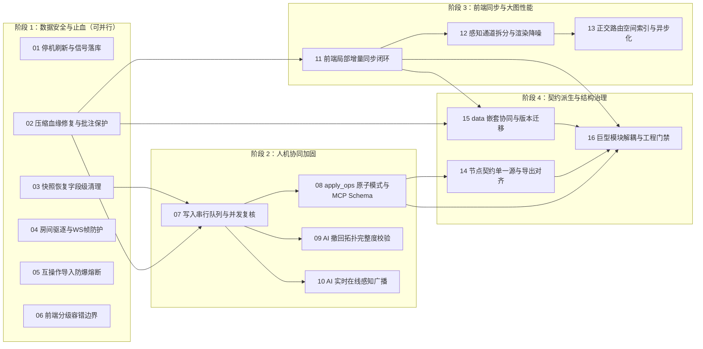

# FlowStudio 架构演进与健壮性优化工单拆解

> 日期：2026-11-18 ｜ 状态：待确认粒度与依赖关系 ｜ 关联规格：[架构演进与健壮性优化规格说明书](./2026-11-18-架构演进与健壮性优化规格说明书.md)

---

## 依赖拓扑总览

**当前可立即并行起手的工单（Frontier）**：`01`、`02`、`03`、`04`、`05`、`06`。

---

## 阶段 1：数据安全与止血

### 01: 服务优雅停机与防抖落库刷新
- **Status:** ready-for-agent
- **Blocked by:** None (can start immediately)
- **What to build:** 当进程收到关闭信号或服务关闭时，系统先停止定时快照调度并关闭协同连接，立即刷新所有处于防抖窗口内尚未写盘的文档状态并等待落库彻底完成后再关闭 SQLite，确保任意停机时机下最新协同编辑零丢失。
- **Acceptance criteria:**
  - [ ] 在活跃协作编辑发生后的防抖窗口内触发服务关闭，重连数据库读取能够完整保留最后一次编辑内容。
  - [ ] 服务关闭过程不触发异步持久化写库与数据库关闭之间的竞态异常。
  - [ ] 进程注册标准退出信号监听并完整走完服务关闭钩子。

### 02: 修复大图状态压缩血缘冲突与保护画布批注
- **Status:** ready-for-agent
- **Blocked by:** None (can start immediately)
- **What to build:** 下线运行时用随机新文档重建状态后再合并旧状态的压缩逻辑，避免已删图元复活与编辑回退；建立包含 `nodes`、`edges`、`meta`、`comments` 在内的全局共享容器清单，使大图的批注评论与主体图元一样受事务异常回滚、快照操作保护；为存在历史膨胀数据的文档提供一次性离线清洗与 `docEpoch` 客户端重置协同契约。
- **Acceptance criteria:**
  - [ ] 超过原体积阈值（2MB）的文档在完成节点删除与编辑并持久化重开后，已删节点不会复活、最新修改不会回退、批注评论完整保留。
  - [ ] 事务回调抛出异常触发补偿回滚时，同事务内写入的批注变更能够一并回滚。
  - [ ] 离线清洗迁移脚本执行后，文档体积有效收敛且 `docEpoch` 变化可引导已连接客户端无错重建同步。

### 03: 快照差量恢复子字段清理与零冗余重写
- **Status:** ready-for-agent
- **Blocked by:** None (can start immediately)
- **What to build:** 升级历史快照差量恢复逻辑，使恢复不仅移除快照后新增的顶层节点与连线，还清理快照之后附加到既有图元上的内部多余字段（如后续误挂的父子关联或样式字段），并对值未发生变化的属性跳过写操作以防止生成冗余 CRDT 历史。
- **Acceptance criteria:**
  - [ ] 节点在生成快照后被拖入泳道（附加 `parentId` 等字段），恢复该快照后节点脱离泳道且 `parentId` 被彻底清除。
  - [ ] 仅修改单节点并恢复快照时，未发生变化的其他节点和连线不产生多余的字段写事件。
  - [ ] 恢复快照后，目标文档上的批注数据按共享容器策略正确还原或保留。

### 04: 删图房间强制驱逐与 WebSocket 建连边界防护
- **Status:** ready-for-agent
- **Blocked by:** None (can start immediately)
- **What to build:** 删除图表时同步强制断开该图表对应的全部在线协同连接并清理内存保存状态记录，杜绝用户停留在无法落库的“幽灵画布”；WebSocket 建连与文档加载校验图表真实存在，并对消息负载大小与畸形非二进制帧进行截断保护；收紧公开 REST 接口对快照参数、缩略图长度、分页及搜索通配符的边界校验，完善未命中 API 的 404 响应隔离。
- **Acceptance criteria:**
  - [ ] 客户端在线编辑期间图表被 REST 删除后，在线客户端 WebSocket 连接被立即断开且内存中不再残留对应保存状态条目。
  - [ ] 使用不存在的 `diagramId` 发起协同建连会被拒绝，不会在内存创建空房间。
  - [ ] 发送超限大小或非法文本帧至协同通道不会导致服务端进程未捕获崩溃。
  - [ ] 误拼写 `/api/*` 或 `/mcp/*` 路径返回结构化 JSON 404 错误而非静态托管的 HTML 页面。

### 05: 外部图表导入（Draw.io / BPMN / Mermaid）防爆熔断与安全校验
- **Status:** ready-for-agent
- **Blocked by:** None (can start immediately)
- **What to build:** 为外部互操作导入链路加装安全闸门：Draw.io 解压采用流式计数在超出安全上限时立即中止；XML 解析拒绝 DOCTYPE/ENTITY 声明并校验 Unicode 码点合法性；计算父子绝对坐标时引入索引映射与环检测防止栈溢出；Draw.io、BPMN、Mermaid 三大入口统一执行原始文本体积与图元数量上限熔断；同时修复树形布局中覆盖固定锁节点纵坐标的问题及分层布局环检测。
- **Acceptance criteria:**
  - [ ] 传入高压缩比膨胀载荷或超大文本时，转换在数毫秒内安全抛错中止，内存占用受控。
  - [ ] 传入含 `<!ENTITY` 声明、越界字符实体（如 `&#9999999;`）或自环 `parentId` 的畸形 Draw.io 文档时，系统不抛 `RangeError` 或栈溢出，而是降级或给出明确错误。
  - [ ] 树形渲染中存在 `fixed` 锁定节点时，渲染后其原坐标保持不变；分层布局遇到有向环时不崩溃。

### 06: 前端分级容错边界与异常保底导出
- **Status:** ready-for-agent
- **Blocked by:** None (can start immediately)
- **What to build:** 在应用根级与编辑器核心区域（画布、侧栏、属性面板）装配分级 React `ErrorBoundary`。当自定义节点、正交连线或畸形协同数据触发渲染期异常时，拦截崩溃避免整页白屏，为用户提供可读的局部降级提示、一键重试以及当前画布 JSON 紧急导出通道。
- **Acceptance criteria:**
  - [ ] 模拟单个自定义节点抛出渲染异常时，页面顶栏与操作栏仍可交互，异常区域显示降级面板且支持导出当前合法图元 JSON。
  - [ ] 修复错误源并点击重试后，画布无需整页刷新即可恢复正常渲染。

---

## 阶段 2：人机协同加固

### 07: 服务端按图串行写入队列与并发乐观复核
- **Status:** ready-for-agent
- **Blocked by:** 02, 03
- **What to build:** 为服务端统一写入引擎建立按 `diagramId` 隔离的串行化执行队列，并修复离线路径与异常路径临时文档泄漏问题；将 `auto_layout` 与 `scaffold_diagram` 等“先读图、再异步计算、后写回”的链路纳入冲突保护，在正式写入事务内二次核对目标图元最新存在性与人工锁（`lockMode`），防止异步计算窗口内人类删节点或新加锁引发崩溃或位置被覆盖。
- **Acceptance criteria:**
  - [ ] 并发触发同图的多个异步修改或自动排版请求时，写入严格串行落库，无互相踩踏。
  - [ ] 在 `auto_layout` 异步计算间隙删除某节点或锁定其位置后提交写入，服务端不抛出空指针崩溃，且新加锁节点的坐标不会被排版结果覆盖。
  - [ ] 所有临时 `Y.Doc` 实例在正常与异常路径下均确定性释放。

### 08: `apply_ops` 原子事务模式与自纠型 MCP 工具契约
- **Status:** ready-for-agent
- **Blocked by:** 07
- **What to build:** 升级 MCP 增量操作引擎：支持原子事务执行模式，当存在逻辑参数错漏或依赖节点缺失时触发事务补偿回滚，保障画布不落入半残态；当实际有效变更数为零时禁止写入空批次账本和多余前置快照；自动从 Zod 校验规则生成完整的 `apply_ops` 工具 JSON Schema 暴露给大模型，补齐所有 MCP 工具的入参校验、`ops` 数量上限及可自纠错误信息；默认撤回匹配涵盖存在残余未撤项的 `partially_reverted` 批次。
- **Acceptance criteria:**
  - [ ] 大模型调用 `tools/list` 时能直接读取全部 10 类操作的具体字段、必填项与枚举约束。
  - [ ] 在原子模式下提交包含“新建节点 + 指向不存在节点的连线”的批次时，整体回滚、画布无残留节点、快照库与 AI 批次表不留空记录，且返回明确的自纠错误提示。
  - [ ] 对已部分撤回的批次再次调用默认 `undo_ai_batch` 时，能继续撤回其中尚未被人工冲突的其余项。

### 09: AI 批次撤回拓扑完整度校验与细粒度样式退让
- **Status:** ready-for-agent
- **Blocked by:** 07
- **What to build:** 强化 AI 批次撤回的拓扑安全护栏：恢复被 AI 删除的连线时校验两端节点当前存活，恢复被删节点时校验父容器存活（否则剥离父引用保留为顶级节点），撤回 AI 新建泳道或分组前校验其内部未挂载人工移入或新增的子节点；同时对节点样式对象执行深层子键比对，避免 AI 改填充色、人类改边框色时的整块误判冲突。
- **Acceptance criteria:**
  - [ ] 人类删除了 AI 曾连线过的某节点后执行 AI 批次撤回，系统跳过恢复该悬挂边并在结果中如实上报，不产生幽灵边。
  - [ ] 人类将手工节点拖入 AI 新建的泳道后执行批次撤回，该泳道被保留而不使手工节点变为悬空孤儿。
  - [ ] AI 修改 `data.style` 下某子属性而人类仅修改另一互不冲突的子属性时，撤回仅还原 AI 所改子属性而保留人类样式修改。

### 10: 服务端 AI 实时在线感知广播
- **Status:** ready-for-agent
- **Blocked by:** 07
- **What to build:** 打通 AI 协作者的画布在线感知链路：当 AI 通过 MCP 执行骨架搭建、增量修改或自动排版时，通过服务端 Hocuspocus 协同感知通道向同房间全部在线浏览器客户端实时广播 AI 代理名称、规划进行中状态及正在操作的目标节点列表，操作完成后自动清除或切回空闲态，使人类在画布上直观看到 AI 的活动边界。
- **Acceptance criteria:**
  - [ ] AI 调用 MCP 工具期间，在线前端能收到携带 `isAi: true`、代理名称及目标节点集的 Awareness 更新并在画布展示对应提示/高亮。
  - [ ] 工具调用结束或失败退出后，AI 感知状态能够及时清理，不会永久挂在在线协作者列表中。

---

## 阶段 3：前端同步与大图性能

### 11: 前端局部增量同步闭环与拖拽态冲突保护
- **Status:** ready-for-agent
- **Blocked by:** 02
- **What to build:** 改造前端状态与 Yjs 的同步管线：将所有常规画布编辑（拖拽定位、文本/样式修改、局部增删、泳道移入）切换为基于 `YjsDiagramBridge` 的节点/连线级增量接口，仅在整图导入与模板替换时保留整图 `setDiagram`；协同监听回灌区分本地 `origin` 并利用变更键进行局部实体引用替换，杜绝双倍全量重建；拖拽期间锁定本地节点位移不被远端更新打断，松手仅增量提交位移；修复三层泳道拓扑排序；协同建连前确保本地初始状态待 `synced` 后水合，支持本地离线缓存并在重连后清理失效选中 ID。
- **Acceptance criteria:**
  - [ ] 单节点移动或改名操作不再触发全图 `nodes`/`edges` 数组重建与无变更节点的引用替换。
  - [ ] 拖拽节点过程中收到远端同事对其他节点的增删更新时，被拖拽节点不跳变，松手后同事的新增节点依然完整保留。
  - [ ] 三级嵌套容器（池 → 泳道 → 业务节点）在远端同步重建后仍严格保持父先于子的顺序。

### 12: 感知通道拆分、零冗余历史与渲染降噪
- **Status:** ready-for-agent
- **Blocked by:** 11
- **What to build:** 剥离协同 Context 中高频更新的 `remoteUsers` 到独立细粒度订阅源，使远端光标移动不穿透重渲染画布节点；在协同模式下停止每次动作全图深拷贝维护闲置的本地历史栈；将 `meta` 纳入协同撤销管理器作用域并移除无条件 `stopCapturing` 以恢复合理连续撤销合并；优化节点与泳道组件的 store selector 并建立派生索引消除全图扫描；切图卸载时彻底清理单例路由状态与防抖定时器。
- **Acceptance criteria:**
  - [ ] 远端协作者高频发送光标坐标时，画布内静止自定义节点组件不发生重渲染。
  - [ ] 协同模式下执行节点操作不再触发全图 `structuredClone`，且切换主题后按 `Ctrl+Z` 可连带主题 ID 一并回滚。
  - [ ] 从图 A 切换至图 B 后，单例路由缓存与界面残留状态（如定时器、缩放锚点）归零不污染图 B。

### 13: 正交避障路由空间索引化与视口外异步调度
- **Status:** ready-for-agent
- **Blocked by:** 12
- **What to build:** 优化正交连线避障与跨线跳接计算：为障碍物与水平线段引入局部空间网格/包围盒索引，仅围绕变更节点周边区域失效重算；将当前视口外的连线重路由迁出同步渲染路径进行分批异步计算，消除千级图元下的主线程拖拽卡顿。
- **Acceptance criteria:**
  - [ ] 在 1000+ 节点和连线规模的画布中连续拖拽单个节点，主线程单帧耗时维持流畅交互水平且仅影响邻近相关连线重路由。
  - [ ] 切图或批量删除时路由索引状态同步重置，无陈旧障碍物残影。

---

## 阶段 4：契约派生与结构治理

### 14: 节点类型契约单一来源与导出/互操作全量对齐（Expand–Contract）
- **Status:** ready-for-agent
- **Blocked by:** 08
- **What to build:** 按 **Expand–Contract** 节奏将节点类型契约收敛至单一事实源：基于共享 `FLOW_NODE_TYPES` 与 `NODE_REGISTRY` 自动推导服务端 MCP Schema、操作枚举与前后端类型定义，并为前端节点组件映射表、图标字典及导出配色表强制添加 `satisfies Record<FlowNodeType, ...>` 编译期穷尽检查；为 SVG/PNG 与离线 HTML 导出补齐 `uml-*`、`arch-*` 与 `rich-card` 渲染分支；在所有调用方迁移完毕后收缩清理历史手写重复枚举与已下线的 MCP 死代码方法。
- **Acceptance criteria:**
  - [ ] 向共享节点清单临时添加一个测试类型后，前后端类型检查能够立即精确指出所有缺失映射的渲染器与导出表。
  - [ ] 包含 UML 生命线、架构分片与富文本卡片的图表导出为 SVG、PNG 与离线 HTML 后，图形与关键业务信息保真，不再退化为普通白板矩形。
  - [ ] 已下线的死接口与重复节点枚举列表被彻底移除。

### 15: `node.data` 嵌套协同与版本迁移基础设施（Expand–Contract）
- **Status:** ready-for-agent
- **Blocked by:** 02, 11
- **What to build:** 建立统一的版本迁移器：在 SQLite 引入 `PRAGMA user_version` 迁移流水线（含 Statement 复用与定时快照增量扫描/上限淘汰），在 Y.Doc `meta` 引入 `schemaVersion` 幂等迁移；通过 Expand–Contract 兼容过渡，将 `node.data` / `edge.data` 由整包对象拆解为按核心属性（`label`、`style`、业务元数据）分键的嵌套 `Y.Map`，使多人或人机同时编辑同一节点的不同数据属性时实现真正无冲突合并。
- **Acceptance criteria:**
  - [ ] 旧版本持久化数据库与老结构 `Y.Doc` 在首次加载时自动幂等升级至目标版本，旧数据零损失。
  - [ ] 客户端 A 修改某节点文本标签与客户端 B（或 AI）并发修改同一节点背景色时，双方同步收敛后同时保留新文本与新颜色。

### 16: 巨型模块解耦、共享构建一致化与工程门禁
- **Status:** ready-for-agent
- **Blocked by:** 08, 11, 14, 15
- **What to build:** 在契约与同步行为稳定后进行结构清理：将 `ai-collaborator` 拆分为查询、命令执行、排版几何、语义巡检与协调门面模块；将 `flow-store` 拆分为画布图数据、交互态、历史协同与界面浮层 Slice 并移除模块级全局变量；为共享包启用 TS Project References 统一跨包编译解析链路；建立代码静态检查（Lint）与 CI 自动化门禁，将按研发轮次命名的测试集按业务功能域重新归档。
- **Acceptance criteria:**
  - [ ] 修改共享包公共类型后，无需额外手工预编译，服务端与前端类型检查均能实时反映正确结果或报错。
  - [ ] 拆分后的服务与前端核心模块保持既有公共测试接缝全部绿灯通过，无模块级可变全局状态残留。
  - [ ] 仓库具备可一键/自动触发的 `lint + typecheck + test` 完整门禁，测试目录按业务域清晰对应。
